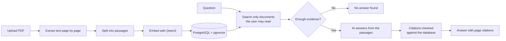

# Pramaan

**Answers with proof from your documents.**

Pramaan (प्रमाण, "proof") is a document platform for a university. Staff upload PDFs, and students and faculty ask questions in plain language. Every answer cites the exact page it came from, and it only uses documents the person asking is allowed to read. When the documents don't contain the answer, Pramaan says so instead of guessing.

    

---

## Features

- Ask questions and get short answers with numbered citations. Click a citation to open the PDF at that page.
- Ask follow-up questions that build on the earlier conversation.
- "No answer found" when the documents don't support an answer.
- Search three ways: Best match (hybrid), Meaning (semantic) and Keywords.
- Summaries of documents up to 40 pages, with page references.
- Compare two documents and see where they differ, with pages on both sides.
- Sharing: faculty choose who can read each document (a role, a person, or nobody else).
- Three roles: Student, Faculty and Admin.
- Admin tools: users, all documents, re-indexing, an audit log and usage analytics.
- Security: rate limits, security headers, and an audit log that never stores passwords, questions or document text.
- Light and dark mode, and works at phone width.

## How it works



- **Permissions live inside the database query**, so a document a user can't read is never searched, counted or sent to the AI.
- **The AI can only cite passages it was given.** Titles and page numbers come from the database, never from the AI.

## Tech stack

| Part | Technology |
|---|---|
| Backend | Java 25, Spring Boot 4.1, Spring AI 2.0 |
| Frontend | React, TypeScript, Vite, Tailwind CSS, React Aria |
| Database | PostgreSQL 18 with pgvector (vectors and keyword search) |
| Embeddings | `qwen3-embedding:0.6b` running locally in Ollama |
| Chat model | OpenAI `gpt-6-luna` (configurable) |
| Running it | Docker Compose |
| Testing | JUnit, Testcontainers, Vitest, Playwright, GitHub Actions |

## Getting started

### Prerequisites

- [Docker Desktop](https://www.docker.com/products/docker-desktop/)
- [Ollama](https://ollama.com/download), then pull the embedding model:
  ```bash
  ollama pull qwen3-embedding:0.6b
  ```
- An OpenAI API key (with a spending limit set on your account)
- Node.js 24 (only for loading the demo data)

### Run

```bash
git clone https://github.com/uttkarsh-thakur26/capstone.git
cd capstone
cp .env.example .env      # then fill in your values (see Configuration)
docker compose up --build
```

Open **http://localhost:3000** and sign in with the admin account you set in `.env`.

### Load demo data (optional)

Creates demo users (admin, two faculty, two students) and sample documents with different sharing, so the permission rules are easy to see:

```bash
node --env-file=.env scripts/demo-data.mjs http://localhost:3000
```

The logins are printed at the end.

## Configuration

Settings live in `.env`. The main ones:

| Variable | What it does |
|---|---|
| `APP_DISPLAY_NAME` | Name shown in the app (`Pramaan`) |
| `OPENAI_API_KEY` | Your OpenAI key. Never commit it |
| `OPENAI_CHAT_MODEL` | Chat model, default `gpt-6-luna` |
| `CHAT_PROVIDER` | `openai`, or `none` to run everything except AI answers |
| `OLLAMA_BASE_URL` | Where Ollama runs, default `http://localhost:11434` |

See `.env.example` for the full list, including the admin account and rate limits.

> **Privacy:** questions and matching passages are sent to the chat model provider. Only upload documents that are allowed to leave your machine.

## Development

```bash
docker compose up -d db                                                 # database only
cd backend && ./mvnw spring-boot:run -Dspring-boot.run.profiles=dev     # API on :8080
cd frontend && npm run dev                                              # UI on :5173
```

API documentation (dev mode): http://localhost:8080/swagger-ui/index.html

### Tests

```bash
cd backend && ./mvnw verify
cd frontend && npm run lint && npm run typecheck && npm test && npm run build
```

Automated tests use fake AI models, so they never call a paid API. CI runs the backend, frontend, Playwright end-to-end and Docker Compose checks on every pull request.

## Project structure

```
backend/    Spring Boot application (API, security, ingestion, search, assistant)
frontend/   React application
docs/       Specification, decisions and progress
scripts/    Demo data loader
compose.yaml
```

## Status

Core features, search, summaries, comparison and administration are complete. Evaluation of answer quality and deployment notes are in progress.

## About

Final-year capstone project (CSET400C), Bennett University.

Built by [Uttkarsh Thakur](https://github.com/uttkarsh-thakur26).
