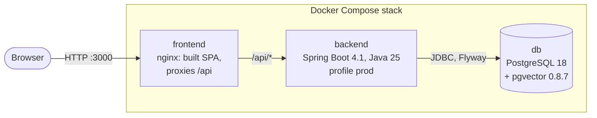

# Architecture

Started in Phase 0. It grows with each phase and is complete for Milestone-2 (specification Section 25). The design itself is specified in `docs/PROJECT_SPEC.md` Section 4; this file describes what exists and how it fits together.

## Containers

- The SPA and the API share one origin: nginx serves the built frontend and forwards `/api` to the backend (AUTH-9, DEP-1). The backend port is not published.
- In development mode (DEP-3) only `db` runs in Compose. The backend runs on the host with the `dev` profile, and the Vite dev server forwards `/api` to it.
- File storage and the model provider (specification 4.2) do not exist yet. They arrive in Phases 2, 3 and 5.

## Backend modules

Package by feature under `in.edu.bennett.capstone.knowledge` (ADR-006), with the module names of specification 4.2. Only modules that contain code exist.

| Module | Status | Responsibility so far | Public API | Depends on |
|---|---|---|---|---|
| `common` | Phase 0 | Application settings (`AppProperties`, `app.display-name`), `GET /api/v1/meta` | `AppProperties`, `MetaResponse` | none |
| `security` | Phase 0 | Default-deny filter chain: only `GET /api/v1/meta`, health, and the API documentation in `dev` are public; everything else answers 401 | none yet | none |
| `user`, `document`, `storage`, `ingestion`, `retrieval`, `assistant`, `conversation`, `audit`, `analytics` | Not started | See specification 4.2 | | |

Module rules are in specification 4.3. The application class runs the JVM in UTC (ADR-016) and leaves out Boot's generated in-memory user until Phase 1 brings real accounts.

## Database

Schema changes go only through Flyway migrations in `backend/src/main/resources/db/migration`; Hibernate validates and never changes the schema (`ddl-auto=validate`).

| Migration | What it does |
|---|---|
| `V1__enable_pgvector.sql` | Creates the `vector` extension |

## Frontend

React 19 with TypeScript 6 (ADR-010), built by Vite 8. `src/api/schema.d.ts` is generated from the backend's OpenAPI document (`npm run gen:api`, ADR-017) and never edited by hand. `src/api/meta.ts` is the only API call so far.
