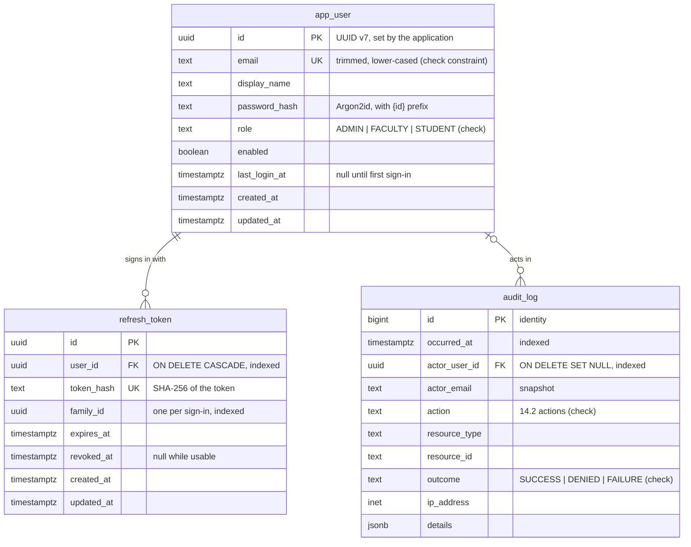

# Data model

Started in Phase 1. It grows with each phase and is complete for Milestone-2 (specification Section 25). The design is specified in `docs/PROJECT_SPEC.md` Section 7; this file describes the tables that exist and why they look the way they do.

## Tables so far

| Migration | Phase | What it does |
|---|---|---|
| `V1__enable_pgvector.sql` | 0 | Creates the `vector` extension |
| `V2__app_user.sql` | 1 | Accounts |
| `V3__audit_log.sql` | 1 | Audit entries, with the trigger that keeps them append-only |
| `V4__refresh_token.sql` | 1 | Refresh tokens |

Hibernate validates the schema at startup (`ddl-auto=validate`) and never changes it; every change is a new Flyway migration.

## Table notes

**`app_user`.** One row per account; accounts are disabled, never deleted (AUTH-11). The email is unique, and a check constraint requires it to be stored trimmed and lower-cased, so the unique key cannot be bypassed with `A@x.org` next to `a@x.org` (AUTH-10). The role is text with a check constraint, not an ordinal (7.1). The password hash carries the encoder's id, `{argon2@SpringSecurity_v5_8}`, so the algorithm can change later without invalidating stored hashes (ADR-022). Written through JPA; `created_at` and `updated_at` come from JPA auditing on the injected `Clock`.

**`refresh_token`.** One row per issued refresh token. Only the SHA-256 of the token is stored: the database never holds a value that could be replayed (AUTH-6). A deterministic hash is needed because the token is looked up by its value, and 256 random bits cannot be guessed, so a slow hash such as Argon2id would add nothing (ADR-020). Every token rotated from one sign-in shares a `family_id`; presenting a token that was already rotated revokes the whole family. Rows reference the user by id only, because the account entity belongs to the `user` module (specification 4.3). Expired and revoked rows are not deleted yet (`docs/PROGRESS.md`, known issues).

**`audit_log`.** Append-only (ADR-024). It has no `created_at` or `updated_at`: `occurred_at` is the time, and rows never change. A trigger rejects `UPDATE`, `DELETE` and `TRUNCATE`, because the application connects as the table's owner, whom a `REVOKE` would not bind. Rows are written through `JdbcClient`, not JPA, so there is no entity that Hibernate could update. `actor_email` is a snapshot, so an entry still names its actor after the account changes. The check constraint on `action` already lists every action of 14.2, so later phases need no migration to record theirs. `ip_address` is the client's address as nginx saw it (ADR-024). `details` never holds passwords, tokens or keys (AUD-2); the service refuses detail keys that name one.

## Integrity rules in force

| Rule | Where it is enforced |
|---|---|
| Emails unique and normalized (AUTH-10) | Unique key and check constraint on `app_user.email`; normalized in the request records too |
| One role per user, from a fixed set (5.1) | Check constraint on `app_user.role` |
| Refresh tokens die with their user | `refresh_token.user_id` `ON DELETE CASCADE` |
| Audit entries are never changed or removed (7.2) | Trigger on `audit_log`; no update or delete method in code |
| An audit entry outlives its actor's account | `audit_log.actor_user_id` `ON DELETE SET NULL` plus the `actor_email` snapshot. Because the trigger also refuses the `SET NULL` update, deleting a user who has audit entries is refused, which matches AUTH-11 |
| Foreign keys used in lookups are indexed (7.1) | `refresh_token(user_id)`, `refresh_token(family_id)`, `audit_log(actor_user_id)` |
| The last enabled admin stays (AUTH-2) | In the service, under a row lock on the enabled admins (`SELECT … FOR UPDATE`), not in the schema |
